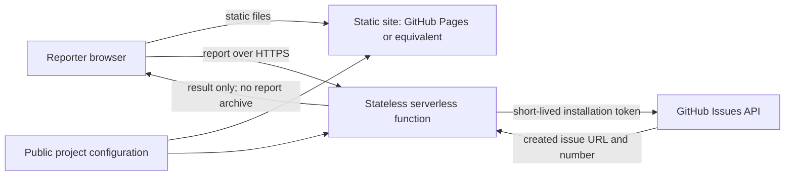

# IssueFoyer: vision and technical design

## Vision

IssueFoyer gives people a clear, low-friction way to report a problem to an open-source project, even if they do not use GitHub. A maintainer gets a well-structured GitHub issue in the repository they already work in.

IssueFoyer is a reusable, customizable open-source project. Apertrust is its first intended deployment, not a special case in the product design.

**A reporter describes the problem in a friendly web form. IssueFoyer validates and forwards the report to the project's issue tracker. The tracker remains the system of record.**

## Product principles

- **Easy for reporters.** Use plain language, short forms, accessible controls, and useful prompts. Do not require knowledge of GitHub or a GitHub account.
- **Keep maintainers in their tracker.** A successful report becomes a native issue with a useful title, consistent sections, and configured labels. Maintainers do not need another inbox.
- **Do not keep a second issue database.** IssueFoyer does not store submitted reports or mirror issue state. GitHub Issues is authoritative in the first release.
- **Customizable per project.** Projects can set their name, logo, colours, introduction, form questions, categories, labels, and issue templates through configuration rather than a fork.
- **Small and deployable.** The reporter interface is a static site. A small serverless endpoint handles the one operation that cannot safely run in a browser: authenticating and creating an issue.
- **Provider boundaries stay explicit.** The first provider is GitHub Issues. The report form and provider adapter should allow GitLab and Gitea later without pretending their APIs are identical.

## Audience and core journey

The primary reporter is a user of an open-source application who can explain what they saw but may not have a GitHub account or understand issue trackers. The maintainer is already working in the project's GitHub repository.

1. The reporter opens the project's IssueFoyer page.
2. They choose a report type and answer a small set of guided questions.
3. The page explains what information will be public on GitHub and asks them to remove secrets or personal data.
4. The reporter submits without signing in.
5. IssueFoyer creates a GitHub issue and shows its link and issue number.

The happy path should work on desktop and mobile, with keyboard navigation and screen-reader labels. Errors should tell the reporter what they can do next without exposing credentials or internal details.

## Scope

### First release

- One project configuration per deployment.
- Static, responsive report page, hosted on GitHub Pages or another static host.
- A small serverless submission endpoint, initially deployable as a Cloudflare Worker or equivalent.
- GitHub App authentication, installed by the maintainer on the target repository with Issues: write and Metadata: read permissions. The endpoint requests an installation token limited to that repository and the Issues permission.
- Bug report form with project-configured fields and labels.
- Server-side validation, safe issue-body rendering, duplicate-submit protection, and a clear success page linking to the created issue.
- Documentation for local development, GitHub App setup, deployment, customization, and privacy.

### Not in the first release

- A maintainer dashboard, report inbox, account system, or database of submissions.
- Issue status synchronization, comments, or reporter notifications.
- File uploads or screenshots. These introduce storage, abuse, and privacy concerns; add them only with an explicit design for direct upload and retention.
- AI classification, automatic issue merging, voting, public roadmaps, analytics, and project discovery.
- Multiple issue-tracker providers. Keep the provider interface ready for them, but validate the GitHub flow first.

## Technical design

### Components



**Static site.** Serves the form and project branding. It contains no secrets. Project configuration may be public and can be built into the site or fetched as a versioned JSON file.

**Submission endpoint.** Validates the request, selects the configured repository, obtains a short-lived GitHub App installation token, creates the issue, and returns only the result needed by the browser. It does not save the report. The endpoint must not accept an arbitrary repository name from the browser.

**GitHub App.** Installed by a project maintainer on the intended repository. The app's private key is a secret held by the deployment platform, never by the browser or the repository. The app ID and installation ID are deployment configuration values. Installation tokens are short-lived and should be created on demand and kept only in memory for the request where feasible.

**GitHub Issues.** The durable record for reports. Labels, issue templates, and repository permissions remain under maintainer control.

### Hosting model

GitHub Pages can host the static front end, but it cannot securely hold a GitHub App private key or perform privileged issue creation on its own. A small serverless function is therefore required for the no-GitHub-account reporter flow.

The recommended first deployment is:

- Static front end: GitHub Pages, with a custom domain optional.
- Submission endpoint: a serverless or edge function such as Cloudflare Workers.
- Secrets: the function platform's secret store.
- Issue data: GitHub Issues only; no IssueFoyer database.

The design should keep the front end deployable to any static host and the endpoint portable across serverless platforms. Platform-specific code belongs in a thin adapter, not in the form logic.

A fully static alternative can link to GitHub's new-issue page with a prefilled template, but reporters then need a GitHub account and must finish submission on GitHub. This is a useful fallback mode, not the primary experience.

### Project configuration

Use a validated, versioned configuration file rather than a project-specific code fork. The initial format can be YAML, compiled to JSON at build time. Example:

```yaml
schemaVersion: 1
project:
  name: Apertrust
  description: Report a problem.
  repository: apertrust/apertrust
  website: https://apertrust.org
  branding:
    logo: /assets/logo.svg
    accentColor: "#6d8f75"
  category:
    id: bug
    label: Report a problem
    githubLabels: [bug]
  questions:
    - id: expected
      type: longText
      label: What did you expect to happen?
      required: true
    - id: actual
      type: longText
      label: What happened instead?
      required: true
    - id: steps
      type: longText
      label: How can we reproduce it?
      required: true
```

The schema must constrain question types and label values. It must not allow configuration to inject executable HTML or arbitrary script. The endpoint uses trusted deployment configuration for the repository and allowed labels; it does not trust client-supplied labels or repository identifiers.

### Submission contract

The browser sends a small JSON payload containing a request identifier, selected category, answers, and an optional client-generated diagnostic context explicitly shown to the reporter. The endpoint:

1. Checks request size, content type, origin policy, required fields, and configured limits.
2. Validates category and fields against the project configuration.
3. Normalizes and escapes content into a predictable Markdown issue body. Treat all reporter text as untrusted input.
4. Applies only server-configured labels and a stable IssueFoyer marker for support and duplicate-submit handling.
5. Creates the issue through the GitHub App installation token.
6. Returns the issue URL and number, or a safe, actionable error.

Use a client-generated request ID as a marker in the issue body and check for that marker in GitHub before retrying an ambiguous submission. This reduces accidental duplicates without maintaining a separate report store, but it cannot guarantee exactly-once creation if requests race or GitHub is temporarily unavailable. Explain this limitation in the UI when a submission result is uncertain; do not claim guaranteed delivery.

### Privacy and abuse controls

Reports become public GitHub issues. The form must say this before submission and should remind reporters not to include passwords, private keys, personal information, or confidential files. Avoid collecting email addresses in the first release; a public issue is not a safe place to put private contact details, and private follow-up would require another data-handling design.

The endpoint should use HTTPS, strict request-size limits, origin checks as a browser safety measure, per-project quotas or edge rate limiting, and a challenge such as Turnstile when abuse requires it. CORS and origin checks alone do not prevent scripted requests. Secrets must never appear in page source, client bundles, logs, error messages, or generated artifacts. Logs should exclude report bodies and tokens by default.

“No issue database” means reports and issue state are not stored by IssueFoyer. Abuse-prevention counters, transient request IDs, hosting logs, and GitHub's own issue data are separate and must be documented honestly; platform rate-limiting features may retain limited operational metadata.

### Accessibility, localization, and customization

- Meet WCAG 2.2 AA as a target, including keyboard operation, visible focus, labels, error summaries, and sufficient contrast.
- Store user-facing strings in locale files; ship English first and make translations possible without changing form logic.
- Use project configuration for brand colours and logo, while enforcing contrast and safe URL rules.
- Respect reduced motion and narrow screens. Do not require JavaScript for basic project identity and explanatory content, though submission itself may use JavaScript.

### Provider boundary

Define a provider-neutral submission request and result, then implement a GitHub Issues adapter first. Keep GitHub App credentials, label translation, issue formatting, and API error mapping inside that adapter. Later adapters can map the shared form model to GitLab or Gitea issues and document provider-specific limits. Avoid an abstraction that hides essential differences such as permissions, labels, or rate limits.

## Operational model

- Each deployment is configured for a specific project and repository.
- Maintainers own the GitHub App installation and deployment secrets.
- Configuration and frontend assets are reviewed and version-controlled alongside the deployment.
- No IssueFoyer operator can see reports by default; reports go directly to the project's tracker.
- The project should publish a security policy and a support path for deployment issues, while telling reporters that security vulnerabilities must use the repository's private security reporting channel.

## Recommended v1 decisions

- **Deployment:** publish a reusable static-site and Cloudflare Worker template, with GitHub Pages as the documented frontend path. Keep the API contract portable so another serverless host can replace the Worker.
- **GitHub App:** each deployment owner creates and installs a dedicated GitHub App for one repository. This avoids a central IssueFoyer service becoming a trusted intermediary for every adopter. Provide a setup guide and an App manifest to reduce manual setup.
- **Form schema:** support a small, safe set of field types: short text, long text, single choice, and checkbox. Keep the first configuration schema declarative; no arbitrary HTML, JavaScript, or expression language.
- **Issue types:** start with bug reports. Add feature suggestions after the report flow and issue formatting have proven useful; this keeps the first form focused.
- **Abuse challenge:** require a configurable challenge on public production deployments, with Turnstile as the first supported option. Allow it to be disabled for local development. Rate limiting and request-size limits remain required independently.
- **Duplicate handling:** do not add a database. Put a request marker in the GitHub issue body and use it for best-effort retry detection. State clearly that an ambiguous timeout can still result in a duplicate.
- **Attachments and private contact:** defer both. Attachments need a storage/retention design, and private follow-up needs a private channel; neither belongs in a no-report-storage MVP.

These are product and architecture recommendations for the first implementation. Revisit them only when user feedback or deployment experience exposes a concrete need.

## References

- [GitHub REST API: create an issue](https://docs.github.com/en/rest/issues/issues#create-an-issue)
- [GitHub App permissions required for REST endpoints](https://docs.github.com/en/rest/authentication/permissions-required-for-github-apps)
- [Authenticate as a GitHub App installation](https://docs.github.com/en/apps/creating-github-apps/authenticating-with-a-github-app/authenticating-as-a-github-app-installation)
- [GitHub Pages](https://docs.github.com/en/pages)

## Success criteria

- A first-time reporter can file a useful report without a GitHub account or tracker knowledge.
- The report is created directly in the configured GitHub repository and the reporter receives its URL.
- Maintainers do not need to sign in to or triage a separate IssueFoyer inbox.
- A project can change branding, copy, fields, and labels through configuration.
- The deployment has no IssueFoyer report database and no GitHub credential in the browser.
- The setup guide lets another open-source project deploy the portal without forking application code.
